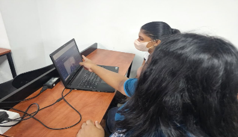
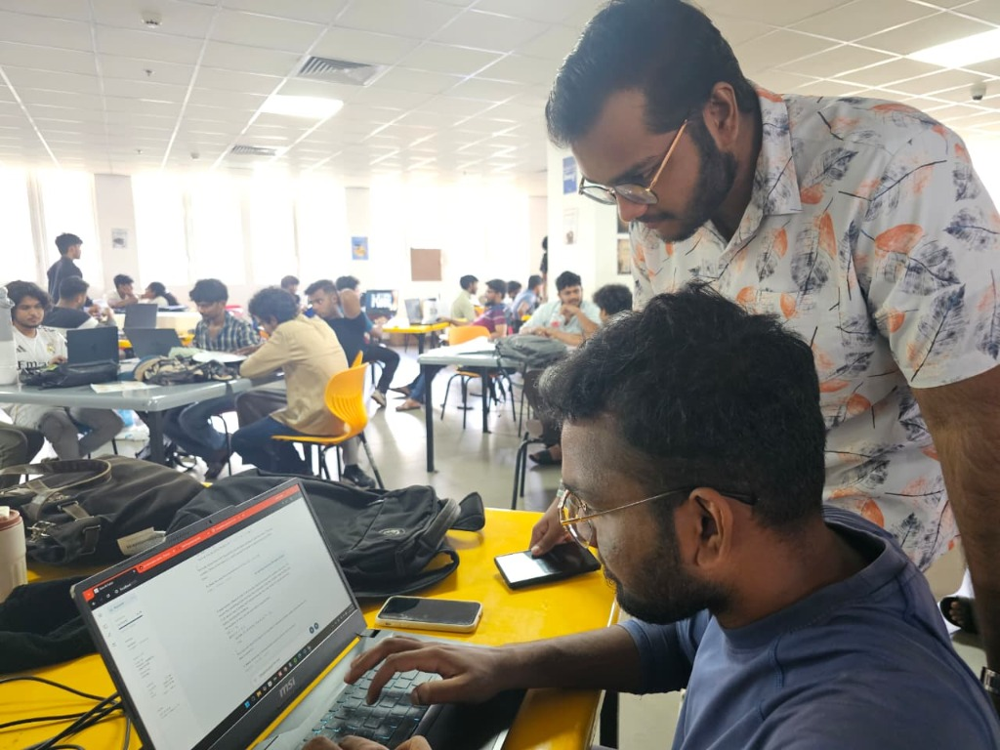

# J26-IT-304: AI-Based Adaptive Programming Learning Platform with Automated Code Evaluation and Teacher Analytics

## 📖 Project Overview
Java programming is a foundational but high-failure-rate subject for orientation and first-year undergraduate students. This project (J26-IT-304) replaces traditional static, one-size-fits-all instructional approaches with a fully personalized, data-driven adaptive learning environment. The platform integrates four core AI modules—a Curriculum-Aware RAG Chatbot, an Adaptive AI Voice Tutor, a Mastery-Based Quiz Generator, and an Attention-Monitored Video Learning System—all synchronized through a shared student profile layer.

## 🚨 Problem Statement
* **Premature Exposure:** Standard AI chatbots provide unrestricted responses, exposing beginners to advanced concepts before they have learned the prerequisites.
* **Fake Confusion Detection:** Existing voice tutors rely on fixed keyword rules rather than trained ML classifiers, failing to distinguish between genuine learning difficulty and simple student preference.
* **Compounding Knowledge Gaps:** Static assessments allow students to progress without genuinely mastering individual concepts, leaving compounding knowledge gaps.
* **Passive Video Consumption:** Video-based learning lacks real-time attention monitoring, meaning missed topics are never mapped to personalized post-video assessments.

## 🎯 Project Objectives
1. **Curriculum Gating:** Restrict AI chatbot retrieval to only the concepts a student has successfully completed in their lectures.
2. **Dynamic Strategy Escalation:** Detect confusion from spoken/text natural language and escalate pedagogical strategies (Theory $\rightarrow$ Example $\rightarrow$ Simplified $\rightarrow$ Analogy) dynamically.
3. **Mastery-Based Progression:** Continuously generate targeted questions based on a Java Knowledge Graph until a student achieves a strict mastery threshold.
4. **Attention-to-Assessment Loop:** Map real-time webcam attention to transcript-defined topics, using distraction tiers to sequence the difficulty of generated MCQs.

---

## ✅ Core System Components & PP1/PP2 Progress Checklist

This section outlines the individual contributions, completed Progress Presentation 1 (PP1) milestones, and the roadmap for Progress Presentation 2 (PP2).

### Component 1: Curriculum-Aware RAG-Based AI Chatbot

**Owner:** Mapatuna M.D.N (IT23157682)

*A curriculum-aware Java programming chatbot that uses Retrieval-Augmented Generation (RAG) to answer student questions using only completed lecture materials.*

**PP1 Contributions (Completed) 🏆**

- [x] Developed a local RAG pipeline using Sentence Transformers, ChromaDB, and a locally hosted LLM.
- [x] Integrated `all-MiniLM-L6-v2` for generating semantic embeddings of lecture content and student questions.
- [x] Implemented slide-level lecture chunking with lecture and slide metadata.
- [x] Integrated ChromaDB as the persistent vector database for storing and retrieving lecture content.
- [x] Integrated Qwen2.5-Coder-3B-Instruct (GGUF, Q4_K_M) through llama.cpp for local AI answer generation.
- [x] Implemented curriculum gating to restrict retrieval to completed lectures.
- [x] Added topic-scope checking and content-margin validation to reduce incorrect blocking of valid questions.
- [x] Implemented handling of locked-topic and unrelated questions.
- [x] Evaluated curriculum-gating behaviour using gate-on/gate-off comparisons and held-out tests.

**PP2 Roadmap (In Progress) 🚀**

- [ ] Add remaining Java lectures and course materials to the vector database.
- [ ] Integrate the chatbot into the shared learning platform and live coding workspace.
- [ ] Improve prompt templates for more accurate and pedagogically appropriate answers.
- [ ] Expand testing with additional held-out questions and student feedback.
- [ ] Improve retrieval and response quality for questions involving related Java concepts.
### Component 2: Adaptive AI Voice Tutor for Java Programming
**Owner:** Lakmal H.U.A.D.Y (IT23335578)
*ML-driven confusion detection and multi-tier strategy escalation.*

**PP1 Contributions (Completed) 🏆**
- [x] Trained and integrated Hybrid Confusion Classifier (TF-IDF + Logistic Regression) with rule-based safety guards.
- [x] Benchmarked ML Confusion Classifier (160 hyperparameter configs via 5-fold `StratifiedGroupKFold`), selecting TF-IDF + Logistic Regression achieving 0.663 Macro F1 and 81.4% Recall.
- [x] Built the Multi-Tier Adaptive Strategy Engine (Theory, Example, Simplified, Analogy).
- [x] Decoupled Local LLM Pipeline (Ollama) with dynamic response generation and deterministic template fallbacks.
- [x] Benchmarked Local LLMs (`llama3.2:3b` vs `qwen3:4b` over prompt revisions r1–r3), achieving 100% shippable form and ~4.6s median generation latency at 220 tokens with GPU acceleration.
- [x] Implemented seamless toggle between voice input and text chat in the UI.
- [x] Replaced generic confirmation prompts with concept-checking questions to detect real understanding.

**PP2 Roadmap (In Progress) 🚀**
- [ ] Expand offline STT (Speech-to-Text) and TTS (Text-to-Speech) benchmarks for full hands-free mode.
- [ ] Implement personalized strategy prioritization using the student's historical learning data.
- [ ] Aggregate multi-session weakness logs and display them on the student dashboard.

### Component 3: Mastery-Based Adaptive Java Quiz Generation
**Owner:** Rathnayake R.M.G.M (IT23182714)
*Identifies weak Java concepts and dynamically generates new practice questions until mastery.*

**PP1 Contributions (Completed) 🏆**
- [x] Developed the Learner Dashboard to display overall learning progress and provide access to 10 Java learning modules.
- [x] Implemented a structured question bank containing 1,000 static Java questions, organized into 100 learning sets.
- [x] Developed the adaptive quiz interface with learning sets, interactive questions, and immediate explanatory feedback.
- [x] Implemented learner performance tracking and weak-concept identification using incorrect answers and concept tags.
- [x] Integrated the Java Knowledge Graph using Neo4j to represent relationships between Java concepts.
- [x] Integrated the local Qwen3-4B LLM through llama.cpp for generating targeted remedial questions.
- [x] Implemented mastery-based progression, requiring learners to achieve at least 9/10 in static quizzes before progressing.
- [x] Developed a remedial assessment mechanism that generates 30 targeted questions, requiring at least 28/30 to pass.

**PP2 Roadmap (In Progress) 🚀**
- [ ] Evaluate the quality, Java correctness, relevance, and difficulty of LLM-generated remedial questions.
- [ ] Test knowledge graph integration and its effectiveness in identifying related weak concepts.
- [ ] Evaluate question diversity and non-repetition across multiple remedial rounds.
- [ ] Refine adaptive question generation based on learner performance and feedback.
- [ ] Conduct user testing and evaluate the usability and effectiveness of the adaptive quiz component.
- [ ] Panel Suggestions = try to use a model. Like to track the performance or to personalize or give a sample quiz and then according to that create the next question or complexity of the questions also customize.

**Technology Stack**
- Backend: Python
- Frontend: HTML, CSS, JavaScript
- Database: SQLite
- Knowledge Graph: Neo4j
- LLM: Qwen3-4B (GGUF)
- Local LLM Inference: llama.cpp

### Component 4: Attention-Monitored Video Learning System
**Owner:** Haputhanthrie D.D (IT23166110)
*Matches low-attention timestamps to the lecture transcript so that the post-video MCQs focus on the parts the student missed.Maps low-attention timestamps to specific video topics to drive post-video MCQ generation.*

**PP1 Contributions (Completed) 🏆**
- [x] Fine-tuned a YOLOv8n attention detector on the Roboflow Student Attention Tracking v2 dataset (1,435 images, 6 student states). Validation results: mAP50 about 0.81, precision about 0.74, recall about 0.73.
- [x] Integrated MediaPipe Face Landmarker for face checking (the video pauses when no face is detected).
- [x] Saved distractions of 10 seconds or more with timestamps (shorter ones are ignored).
- [x] Built the Question Engine: a local Gemma model (via llama.cpp) generates 10 MCQs from the transcript, prioritising the distracted areas.
- [x] Implemented weighted marking by question difficulty (Easy=1, Medium=2, Hard=3) and a quiz score screen.
- [x] Privacy by design: no cloud services, no stored video, local camera processing only.


**PP2 Roadmap (In Progress) 🚀**
- [ ] Live attention intervention: when a student is distracted for more than 10 seconds, show an on-screen cue to regain their attention (for example an alert, a short prompt or a quick recap question), while still recording the distraction for the quiz.
- [ ] Train an additional model to support the intervention (exact role to be finalised with the supervisor).
- [ ] Pass/Fail check (50% of total marks) to unlock the next video module.
- [ ] Set the easy/medium/hard question mix from the student's distraction level.
- [ ] Send identified weak topics and marks to the shared Knowledge Graph / Learner Profile.
- [ ] Add English subtitles from the timestamped transcript for accessibility.
- [ ] Finalize the post-quiz result screen to list the timestamps where the student lost focus.
- [ ] End-of-course summary (where focus was lost, marks) fetched from the knowledge graph.

---

## 🏗️ System Architecture
The platform utilizes a **microservices-inspired architecture** operating on a strictly **Local-First** basis to ensure data privacy and zero API costs.
1. **Shared Learner Profile:** A centralized database tracks per-concept mastery, attention scores, and strategy effectiveness.
2. **Frontend Layer:** React.js interfaces integrating the IDE, video player, voice chat, and quiz dashboard.
3. **Backend Intelligence Layer:** FastAPI microservices handling RAG retrieval, ML Classification, Attention Analysis, and Mastery Gating.
4. **Local LLM Layer:** Ollama running quantized models (`llama3.2:3b`, `Qwen2.5-Coder`) to generate responses and MCQs natively on institutional hardware.

## 📊 Data Collection & Ethical Approval

### 📦 Component-Wise Datasets
| Component | Dataset / Data Source | Purpose & Description |
|---|---|---|
| **Component 1:** Curriculum-Aware RAG Chatbot | **Institutional Java Curriculum and Lecture Materials** | Java lecture slides and learning materials are processed into slide-level chunks with lecture and slide metadata. Sentence Transformers (`all-MiniLM-L6-v2`) generates embeddings, which are stored in ChromaDB. The retrieval pipeline uses completed-lecture information and curriculum validation to restrict access to unlearned content. |
| **Component 2:** Adaptive AI Voice Tutor | **`JavaQuestionSynthFinal` (HuggingFace) + OOD Diagnostic Probes** | Pinned synthetic dataset (`nitinnovtech-ai-space/JavaQuestionSynthFinal` @ `e29cfdd4`) containing beginner Java Q&A pairs labeled by correctness as a proxy for confusion to train the TF-IDF + Logistic Regression model. Augmented with behavioral probe sets to tune deterministic rule guards. |
| **Component 3:** Component 3: Mastery-Based Quiz Generator | **Curated Java Question Repository (static_questions.json) + Java Knowledge Graph (java_knowledge_graph.json and java_concept_graph.json)** | A curated repository containing 1,000 pre-tagged Java questions organized into 10 learning modules, 100 learning sets, and concept tags. The Java Knowledge Graph, implemented using Neo4j, represents relationships between Java concepts and their prerequisites. Learner performance and incorrectly answered concept tags are used to identify weak areas. These are used to guide the local Qwen3-4B LLM in generating targeted, non-repetitive remedial questions to support mastery-based learning. |
| **Component 4:** Attention-Monitored Video System | **Roboflow Student Attention Tracking v2** | 1,435 labelled classroom images (YOLOv8 format, 640x640) with 6 states: Attentive, Daydreaming, Distracted, Hand Rising, Phone Use, Sleepy. Used to fine-tune YOLOv8n. Distraction times are matched with the lecture transcript to choose the quiz topics. |

### 🛡️ Ethical Approval & Privacy-by-Design
*   **Zero Persistent Biometric Storage:** No raw webcam video feeds, facial landmark coordinates, or microphone audio recordings are ever written to disk or transmitted to external servers. All processing (MediaPipe, YOLOv8n, Faster-Whisper) occurs strictly in-memory (RAM) on local hardware.
*   **Explicit Informed Consent:** Transparent UI indicators, active recording visualizers, and opt-in switches ensure students explicitly authorize camera and microphone usage before sensors engage.
*   **Institutional Ethical Review:** Human participant evaluations and classroom testing protocols scheduled for PP2 comply with SLIIT ethical review board standards and institutional data privacy requirements.


## 🧠 Machine Learning Pipeline
*   **Voice Tutor:** `Text -> TF-IDF Vectorizer -> Logistic Regression -> Strategy Class`
*   **Video Attention:** `Webcam frame -> YOLOv8n (student state) + MediaPipe (face present?) -> Attentive / Distracted -> distraction of 10 s or more saved with timestamp`
*   **Generative Pipelines:** `Transcript + distraction timestamps -> prompt -> local Gemma (llama.cpp) -> JSON-schema-constrained output -> quiz and marks`
*   **Planned (PP2):** `Distraction reaches 10 s -> on-screen attention cue -> distraction still logged for the quiz`


## 💻 Technology Stack
*   **Frontend:** React 19, TypeScript, Vite, Tailwind CSS
*   **Backend:** Python 3.13, FastAPI
*   **Local AI / LLMs:** Ollama, Llama 3.2, Qwen2.5-Coder, llama.cpp with a Gemma GGUF model (question generation)
*   **Computer Vision & Audio:** Ultralytics YOLOv8n, MediaPipe, OpenCV, PyTorch, NumPy, Pillow
*   **Data Science:** Scikit-Learn, Pandas, NumPy
*   **Vector Database:** ChromaDB / FAISS (for RAG)

## 📁 Project Structure Overview (Monorepo)
```text
J26-IT-304/
├── backend/                  # FastAPI Backend Service (Adaptive AI Voice Tutor)
│   ├── app/                  # Application source code
│   │   ├── classifier/       # Hybrid confusion classifier (TF-IDF + Logistic Regression & rules)
│   │   ├── escalation/       # Multi-tier pedagogical strategy escalation engine & session tracking
│   │   ├── generation/       # LLM prompt builder, Ollama adapter & deterministic template fallbacks
│   │   ├── config.py         # Application configuration & environment settings
│   │   ├── orchestrator.py   # Pipeline orchestration between classifier, engine, and LLM
│   │   ├── schemas.py        # Pydantic data models and API request/response schemas
│   │   └── topics.py         # Java topic catalogue and curriculum scope definitions
│   ├── benchmarks/           # Performance, latency, and response quality benchmarks
│   ├── models/               # Trained model artifacts (clf-v1.0.0 confusion classifier)
│   ├── scripts/              # Utility scripts for data validation and model testing
│   ├── tests/                # Pytest unit and integration test suites
│   ├── compose.yaml          # Docker Compose container orchestration
│   ├── Dockerfile            # Container build specification
│   └── requirements.txt      # Python runtime dependencies (Python 3.13)
├── frontend/                 # React 19 + TypeScript + Vite + Tailwind CSS Web Application
│   ├── src/
│   │   ├── components/       # Reusable UI & shader/canvas visualizer components
│   │   ├── features/
│   │   │   └── tutor/        # Voice tutor UI, audio visualizers (Aura & Wave), chat & episode store
│   │   ├── hooks/            # Custom React hooks (speech input, microphone, media streams)
│   │   ├── lib/              # Shared helper functions and utility definitions
│   │   ├── index.css         # Styling system, design tokens, and theme configurations
│   │   └── main.tsx          # Application entry point
│   ├── public/               # Static assets, branding, and icons
│   ├── package.json          # Node dependencies & project build scripts
│   └── vite.config.ts        # Vite build tool and development server configuration
├── experiment1/              # Research & ML Experiments for Confusion Classifier
│   ├── confusion_baseline/   # Baseline model architectures and benchmark comparisons
│   ├── data/                 # Training, validation, and probe datasets
│   ├── models/               # Serialized classifier weights, vectorizers, and metrics
│   ├── notebooks/            # Jupyter notebooks for data analysis and model training
│   ├── probe/                # Behavioral probe test cases and diagnostic suites
│   ├── reports/              # Experiment logs and evaluation results
│   └── scripts/              # Data generation, cleaning, and preprocessing pipelines
├── docs/                     # Research assets and project documentation
│   └── images/               # User testing and classroom evaluation evidence photos
├── SETUP.md                  # Comprehensive developer setup guide (backend, frontend, Ollama)
└── README.md                 # System architecture, research documentation, and progress checklist
```

## 🖥️ Demo UI Prototype for Used Data Collection

> 🌐 **Live Prototype:** [https://ai-voice-tutor-demo.vercel.app/](https://ai-voice-tutor-demo.vercel.app/)

The platform's UI serves as the primary data collection point for the ML models in a non-intrusive way:
1.  **Voice / Text Toggle:** Students switch to voice mode, passing microphone blobs to the backend for STT, yielding text data for the TF-IDF classifier.
2.  **Webcam Panel (Video Learning):** A small, indicator-lit preview window shows the student they are being monitored. In-memory frames are processed to yield bounding boxes and EAR (Eye Aspect Ratio) scores.
3.  **Quiz Selections:** Learners' radio-button selections and quiz submissions are processed by the backend assessment system. Their answers and performance are recorded in the SQLite learner database, updating their concept-level progress and identifying weak Java concepts. This information is then used alongside the Java Knowledge Graph to guide adaptive remedial question generation and mastery progression. Important: SQLite stores learner performance, while Neo4j stores Java concept relationships. Keep that distinction clear in your README and viva explanation.
4.  **IDE Workspace:** Keystrokes and run-button clicks inside the React code editor are logged to correlate active coding time against chatbot queries.

## 📸 Research Evaluation & User Testing Evidence

Photographic evidence from ongoing user testing, prototype evaluation, and classroom data collection sessions with undergraduate students:

<p align="center">
  
  
</p>

